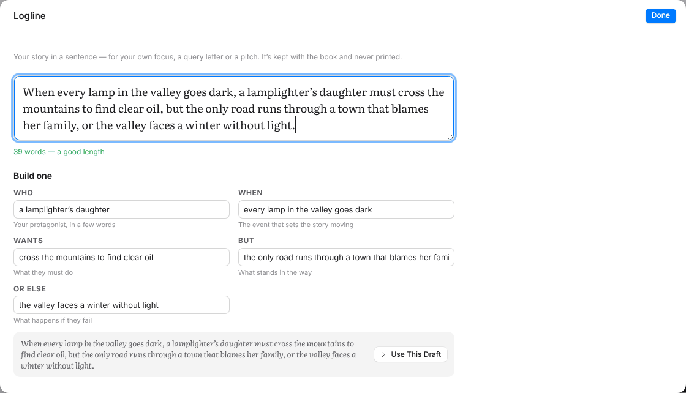
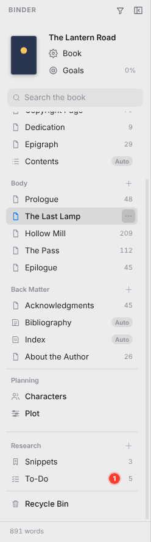
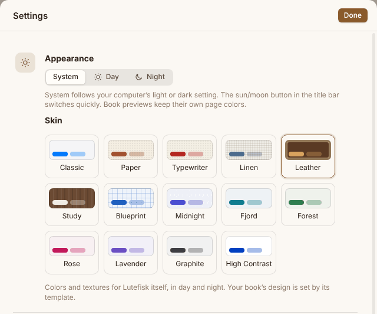

<h1 align="center">Lutefisk</h1>

<p align="center"><b>Write, design and publish books, privately, on your own computer.</b></p>

<p align="center">
  macOS · Windows · Linux &nbsp;|&nbsp; No accounts · No cloud · No tracking
</p>

> [!WARNING]
> **Experimental and unsupported.** Lutefisk is a personal, experimental project. It is provided as is, with no support, no warranty and no promise of updates or fixes. Features may change or be removed at any time, and book files from one version might not open in another. Keep your own backups of anything you write with it, and use it at your own risk. See [Disclaimer](#disclaimer).


Lutefisk is a desktop book studio. You write in a calm editor while a live preview shows the page as it will look on a Kindle, an iPhone, a Galaxy tablet or a printed book. When the book is ready, export it as an EPUB, a print-ready PDF, a Word file and more.

Your books stay on your computer. Lutefisk has no accounts, no cloud sync, no telemetry and no auto-update, and the app window can't reach the internet at all.

---

## Contents

- [Highlights](#highlights)
- [Features](#features)
- [Getting started](#getting-started)
- [Your books](#your-books)
- [Privacy and security](#privacy-and-security)
- [Project layout](#project-layout)
- [Disclaimer](#disclaimer)

## Highlights

### See the finished book while you write

The preview redraws on the next frame after each keystroke. Choose a device, such as the iPad, iPhone, Galaxy S26, Galaxy Tab S11 or the Kindle Basic, Paperwhite or Scribe, and the page is drawn to scale with that screen's real resolution.

### 95 templates, one key press apart

A template sets the whole look of the book: fonts, chapter openings, drop caps, ornaments and scene breaks. The template list sits right under the device. Open it and press **↑** or **↓** to step through the designs; the device shows each one with example text, or with your own book when you turn on **Live**. Press **Enter** to keep a design, or **Esc** to go back. To change a template, click ⚙. Your edited version is saved as *Modified*, and a template you build from scratch is saved as *Custom*.


### Print, as an open book

Switch to **Print** to see facing pages exactly as the PDF will print them. The print view includes trim sizes, running heads, page numbers, footnotes, drop caps, chapters that start on a right-hand page and roman numerals for the front matter.


### Plan before you write

Use the **logline builder** to sum up your story in one sentence. It suggests a draft from five short prompts (Who, When, Wants, But and Or else) and shows when the sentence is a good length.



### Snippets you can drag into place

Save passages for later as **Snippets**, with the same formatting as the editor: bold, italic, underline, lists, block quotes and more. Open the Snippets panel beside the editor and drag a snippet to the exact spot in a chapter or scene. Once it's dropped, the text appears there and the snippet leaves the list.

<p>
  
  
</p>

### A to-do list for every book

Under **Research**, the **To-Do** list keeps track of what's left to do. Each item records when you added and finished it and can have an optional deadline. Tick **Today** to give new to-dos today's date by default. Statistics show what's open, overdue and due this week, how much is complete, and how often you finish on time. A red badge in the binder shows how many to-dos are overdue.

<p>
  
  
</p>

### Code, highlighted

The **</>** button inserts a code block. Choose from dozens of programming, scripting and shell languages (Python, JavaScript, Bash, PowerShell, Go, Rust and many more) and data formats such as JSON, YAML and XML. Highlighting looks the same in the editor, the preview and every export. Line numbers are off by default; switch them on for any block.


### A Recycle Bin

Deleted chapters, scenes, research notes, snippets, to-dos, characters and plot cards go to the **Recycle Bin** at the bottom of the binder. **Restore** puts an item back where it was. **Delete Forever** or **Empty Recycle Bin** removes items for good.


### Know your text

**Insights** charts your writing history and analyzes the text itself. It reports readability scores, sentence lengths, dialogue, adverbs, passive voice and a breakdown by section. **Reset…** clears the writing history for one book or for all of them.


### Make it yours

Lutefisk has day and night modes and 14 skins. Some skins are plain colors, and others add a texture, such as stitched Leather, a walnut Study, woven Linen, a Blueprint grid or Midnight's field of stars.

<p>
  
  
</p>

<p align="center"></p>

## Features

| | |
|---|---|
| **Write** | Paragraph styles, lists with custom bullets, footnotes, citations (APA, MLA and Chicago), equations, tables, images, code blocks with highlighting and optional line numbers, comments, find and replace, focus mode, text size from 25% to 300%, and a title capitalization check that follows your citation style |
| **Structure** | Front matter, chapters and scenes, and back matter, with a generated title page, contents, bibliography and index |
| **Plan** | A logline builder; Planning, with characters (with portraits) and a plot board; and Research, with formatted Snippets you drag into the text and a To-Do list with deadlines and statistics |
| **Recover** | A Recycle Bin for everything you delete, with Restore and Delete Forever |
| **Organize** | Labels, statuses and Exclude from Export for every chapter and scene, with a filter in the binder |
| **Track** | A live word and page count as you type, daily goals, a stopwatch, writing history (which you can reset) and text insights |
| **Preview** | Seven phones, tablets and e-readers drawn to scale, plus a print view with facing pages, a zoom control and a choice of light, sepia or dark reading themes |
| **Export** | EPUB, PDF, Word, RTF, MOBI, Markdown and plain text |
| **Back up** | Save a .zip or a folder copy of any book, beside the book or anywhere you choose (⇧⌘S) |
| **Learn** | Built-in help and a guided tour that walks you through your first book (F1) |

## Getting started

You need [Node.js](https://nodejs.org) 22 or later.

```bash
npm ci        # install dependencies
npm start     # build and launch Lutefisk
npm test      # run the unit tests
```

To build an installable app, run `npm run package:mac`, `npm run package:win` or `npm run package:linux` on that system.

New to Lutefisk? Click **?** in the title bar or press **F1**. The guided tour walks you through making your first book.


## Your books

Each book is an ordinary folder, so you can copy it, sync it yourself or put it under version control:

```
My Book/
├── book.yaml       title, authors, template, settings, snippets and to-dos
├── chapters/       one Markdown file per chapter
└── assets/         cover, pictures and character portraits
```

When you run Lutefisk from its source folder, new books go in `local/books`. Git ignores that folder, so your writing is never committed. A packaged copy of the app keeps books in `Documents/Lutefisk` instead. You can change the folder in Settings.

## Privacy and security

- **Nothing leaves your computer.** The app window is blocked from making network requests. There is one exception: the Bibliography tool fetches a link that you paste. It sends no cookies and none of your book, and it refuses addresses on your local network.
- **Locked-down interface.** The interface is sandboxed and context-isolated, runs under a strict Content-Security-Policy and talks to the rest of the app only through a narrow bridge. The app checks every file path before it touches a file.
- **Safe Markdown.** Raw HTML is disabled. Links must use http, https or mailto, and pictures must come from the book's own `assets` folder.
- **Hardened builds.** Packaged builds turn on Electron's security fuses and refuse debugging switches.
- **Clean dependencies.** `npm audit` reports no vulnerabilities, and `npm run check:deprecated` finds no deprecated packages.
- **Software bill of materials.** `npm run sbom` writes CycloneDX 1.5 and SPDX 2.3 files and a readable summary to `sbom/`.

## Project layout

```
src/main/          main process: windows, files, exports, PDF printing
src/preload/       the narrow bridge to the interface
src/renderer/      the interface: editor, previews, panels, help
src/shared/        Markdown, templates, fonts, citations, book → HTML
scripts/           build, package, SBOM, sample book
test/              unit and end-to-end tests
docs/screenshots/  the images in this README, made from a sample book
CLAUDE.md          the full specification
```

## Disclaimer

Lutefisk is an **experimental, unsupported** personal project.

- **No support.** Questions, bug reports and feature requests may go unanswered.
- **No warranty.** The software is provided "as is", without warranty of any kind. You use it at your own risk.
- **Things may change.** Features can change or disappear between versions, and the book format may change without a migration path.
- **Back up your work.** Lutefisk saves your books as ordinary files on your computer and includes a Back Up command, but it is not a substitute for your own backups.
- **Not for publishing decisions.** Previews and exports aim to be accurate, but always check your files in the store's or printer's own tools before you publish.

