<h1 align="center">Lutefisk</h1>

<p align="center"><b>Write, design and publish books, privately, on your own computer.</b></p>

<p align="center">
  macOS · Windows · Linux &nbsp;|&nbsp; No accounts · No cloud · No tracking · No AI
</p>

> [!WARNING]
> **Experimental and unsupported.** Lutefisk is a personal, experimental project. It is provided as is, with no support, no warranty and no promise of updates or fixes. Features may change or be removed at any time, and book files from one version might not open in another. Keep your own backups of anything you write with it, and use it at your own risk. See [Disclaimer](#disclaimer).

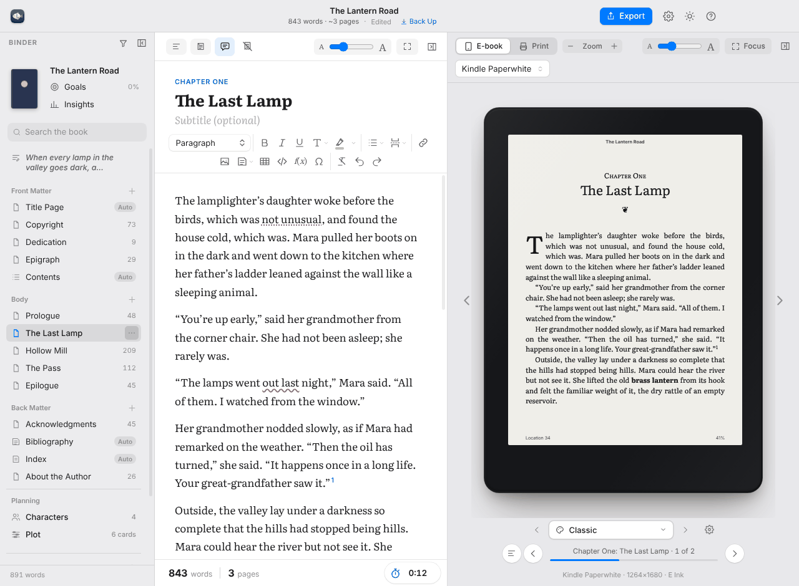

Lutefisk is a desktop book studio. You write in a calm editor while a live preview shows the page as it will look on a Kindle, Kobo or Nook, a phone, a tablet or a printed book. When the book is ready, export it as an EPUB, a print-ready PDF, a Word file and more.

Your books stay on your computer. Lutefisk has no accounts, no cloud sync, no telemetry and no auto-update, and the app window can't reach the internet at all.

> **About AI.** Lutefisk contains **no AI**: nothing in the app generates, rewrites or analyzes your writing with a language model, and nothing is sent to an AI service. The spelling and grammar checker is a conventional rule-based checker that runs locally. The application itself, however, **was built with the help of AI** coding tools.

---

## Contents

- [The editor](#the-editor)
- [See it on real devices](#see-it-on-real-devices)
- [Print, as an open book](#print-as-an-open-book)
- [Templates](#templates)
- [Plan your story](#plan-your-story)
- [Organize and recover](#organize-and-recover)
- [Know your text](#know-your-text)
- [Vision and comfort](#vision-and-comfort)
- [Your language](#your-language)
- [Make it yours](#make-it-yours)
- [Features at a glance](#features-at-a-glance)
- [Getting started](#getting-started)
- [Your books](#your-books)
- [Privacy and security](#privacy-and-security)
- [Project layout](#project-layout)
- [Disclaimer](#disclaimer)

## The editor

Write in a clean, book-like editor with everything a manuscript needs:

- **Styles:** headings, block quotes, verse, hanging indents, and an **Attribution** style for the source line under a quote or epigraph.
- **Formatting:** bold, italic, underline, strikethrough, superscript, subscript, lists with custom bullets, links, footnotes and citations (APA, MLA and Chicago).
- **Highlighter:** mark passages in seven colors, including a bright yellow, as a full, half or underline stroke. Highlights are notes for you and never print.
- **Code:** insert code as a block or inline in a sentence. Blocks get syntax highlighting for dozens of programming, scripting and shell languages, plus JSON, YAML, XML and other data formats, with switches for colors and line numbers. Code has a transparent background and no border, so it suits any page and reading theme. You can add a thin, medium or thick border to a block if you want one. See [Code](#code).
- **Equations:** write LaTeX inline or as a block on its own line, with a live preview, a built-in reference and a symbol palette. See [Equations (LaTeX)](#equations-latex).
- **Comments, find and replace, scenes, and Focus mode,** plus text size from 25% to 300%.

### Equations (LaTeX)

Lutefisk typesets LaTeX math in the editor, the previews and every export.

1. Put the cursor where the equation goes and click **f(x)** in the toolbar, or press ⌥⌘E. You can also right-click and choose **Equation (LaTeX)…**.
2. Choose a **Layout**: **Inline** sits in the sentence, and **Block** sits on its own line, centered.
3. Type LaTeX in the box, for example `\frac{-b \pm \sqrt{b^2-4ac}}{2a}`. The preview typesets as you type and points out mistakes.
4. If you need help, the **Reference** tab explains fractions, roots, sums and integrals, new lines and alignment, matrices, cases and brackets. The **Symbols** tab is a palette of Greek letters, operators, arrows and more. Click an item to insert it.
5. Click **Insert**. To change an equation later, click it.

In Markdown, equations are stored as `$…$` (inline) and `$$…$$` (block). In **Book › General**, under **Equations in e-books**, choose how equations go into e-books: as images, which every reader supports including Kindle and Nook, or as MathML, which is searchable and scalable on Apple Books, Kobo, Google Play and newer Kindles. Print and PDF always typeset equations directly. Each equation keeps its LaTeX as alt text for screen readers.

### Code

Insert code as a block on its own lines or inline in a sentence.

1. Click **</>** in the toolbar, or right-click and choose **Insert Code…**.
2. Choose a **Layout**. **Inline** puts the code in the sentence in a monospaced font. You can also type it between backticks, like `` `print()` ``. **Block** gives the code its own lines.
3. For a block, pick the **Language**. There are dozens, including Python, JavaScript, TypeScript, Bash, PowerShell, SQL, Go and Rust, plus data formats such as JSON, YAML, XML and TOML. Lutefisk remembers your last choice.
4. Turn on **Line numbers** if you want them, and turn **Colors** off for plain text color with no syntax highlighting. Choose a **Border** (none, thin, medium or thick). The default is none.
5. Paste or type the code, or leave it empty and type in the block afterward. Then click **Insert**.

Each block has a bar above it for changing its language, border, colors and line numbers at any time. Code has a transparent background and takes the page's text color, so it reads well on any paper or reading theme. Highlighting matches in the editor, the previews, PDF, EPUB, Word and RTF. To turn highlighting off for a whole book, use **Syntax highlighting in code blocks** in **Book › General**. A shortcut from the keyboard: type ```` ``` ```` and a language name, such as ```` ```python ````, then a space.

### Equations (LaTeX)

Write math the way scientists and textbooks do, in LaTeX, and see it typeset as you type.

1. Put the cursor where the equation goes and click **f(x)** in the toolbar, or press ⌥⌘E. You can also right-click and choose **Equation (LaTeX)…**.
2. Under **Layout**, choose **Inline** to put the equation in the sentence or **Block** to set it on its own line.
3. Type LaTeX in the box, for example `E = mc^2` or `\frac{-b \pm \sqrt{b^2-4ac}}{2a}`. The preview underneath updates as you type and flags mistakes.
4. The **Reference** tab explains how to write fractions, roots, sums, integrals, matrices, cases, aligned equations and new lines. Click an example to insert it. The **Symbols** tab has a palette of Greek letters, operators and arrows.
5. Click **Insert**. To change an equation later, click it. To remove it, select it and press Delete.

In the Markdown files, inline equations are written as `$…$` and block equations as `$$…$$`. The previews, print and PDF typeset them directly. In **Book › General**, choose how EPUBs carry them: as images, which work on every reader including Kindle and Nook, or as MathML, which is searchable and scalable. Word exports use images. Each equation keeps its LaTeX as alt text for screen readers.

### Code

1. Click **</>** in the toolbar, or right-click and choose **Insert Code…**.
2. Under **Layout**, choose **Block** for code on its own lines or **Inline** for code in a sentence, like `print()`. If you've selected a short piece of text first, it opens as Inline with that text filled in.
3. For a block, pick the **Language**. Lutefisk remembers your last choice, and the list covers dozens of programming, scripting and shell languages, plus JSON, YAML, XML, SQL, Dockerfile and more. Choose **Auto-detect** to let Lutefisk guess.
4. Turn **Line numbers** on if you want them, and turn **Colors** off for plain text color with no syntax highlighting. The border picker adds a thin, medium or thick border; the default is none.
5. Paste or type the code, then click **Insert**. You can keep typing inside the block afterwards.
6. Each block has a bar above it in the editor where you can change its language, border, colors and line numbers at any time.

From the keyboard, type three backticks and a language name, such as ` ```python ` followed by a space, to start a block. Type text between single backticks for inline code. Code has a transparent background, so it suits any paper and reading theme. It keeps the same highlighting in the editor, the previews, PDF, EPUB, Word and RTF, and it's never spell-checked.

### Spelling and grammar, on your computer

Lutefisk checks spelling, grammar and style using [Harper](https://github.com/Automattic/harper), an open-source checker built into the app. It runs entirely on your computer, with no account, server or download. Spelling mistakes are underlined in red, grammar in blue and style in dotted purple.

In **Settings › Spelling & Grammar**, choose **Automatic** (checks as you type) or **On Demand**. In On Demand mode, nothing is checked until you click the **ABC** button above the text, press F7, or choose **View › Check Spelling and Grammar**. Each of these checks the text and takes you to the first problem; ⌥F7 steps to the next. Right-click any underlined word for suggestions, to add it to your dictionary, or to ignore it. Your text never leaves your computer.

<p>
  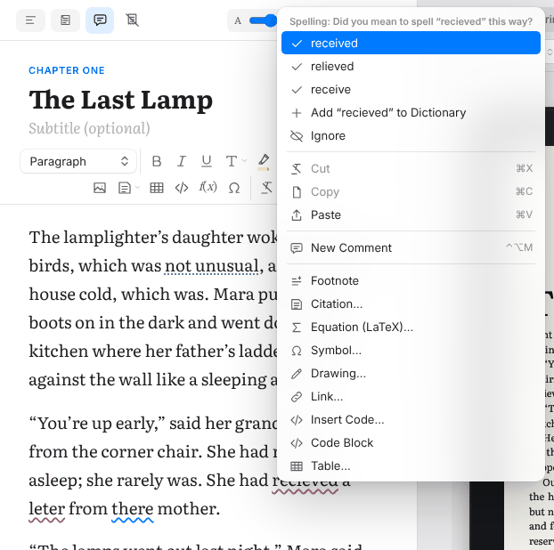
  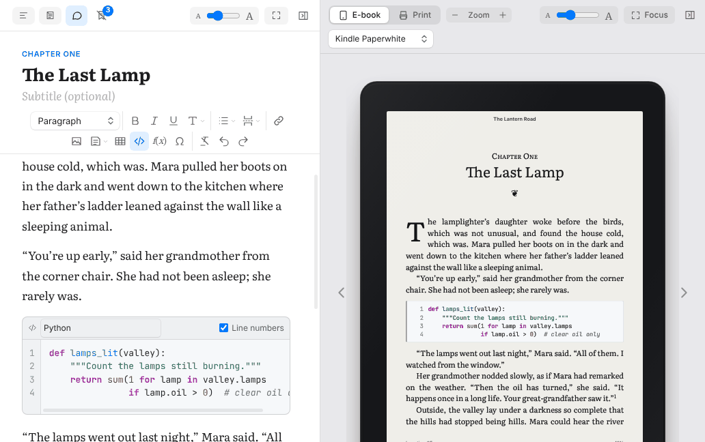
</p>

## See it on real devices

The preview redraws on the next frame after each keystroke. Every device is drawn to scale with its real screen resolution, so line lengths and page breaks look the way your readers will see them:

| | Devices |
|---|---|
| **Apple** | iPad, iPhone |
| **Android** | Galaxy S26, Galaxy Tab S11 |
| **Kindle** | Kindle Basic, Kindle Paperwhite, Kindle Scribe |
| **Kobo** | Libra Color (color E Ink) |
| **Nook** | GlowLight 3, GlowLight 4, GlowLight 4 Plus |

Click the device name and press **↑** or **↓** to switch devices as you go. Phones and tablets have light, sepia and dark reading themes. The text-size slider shows how your book looks to a reader who enlarges the type.

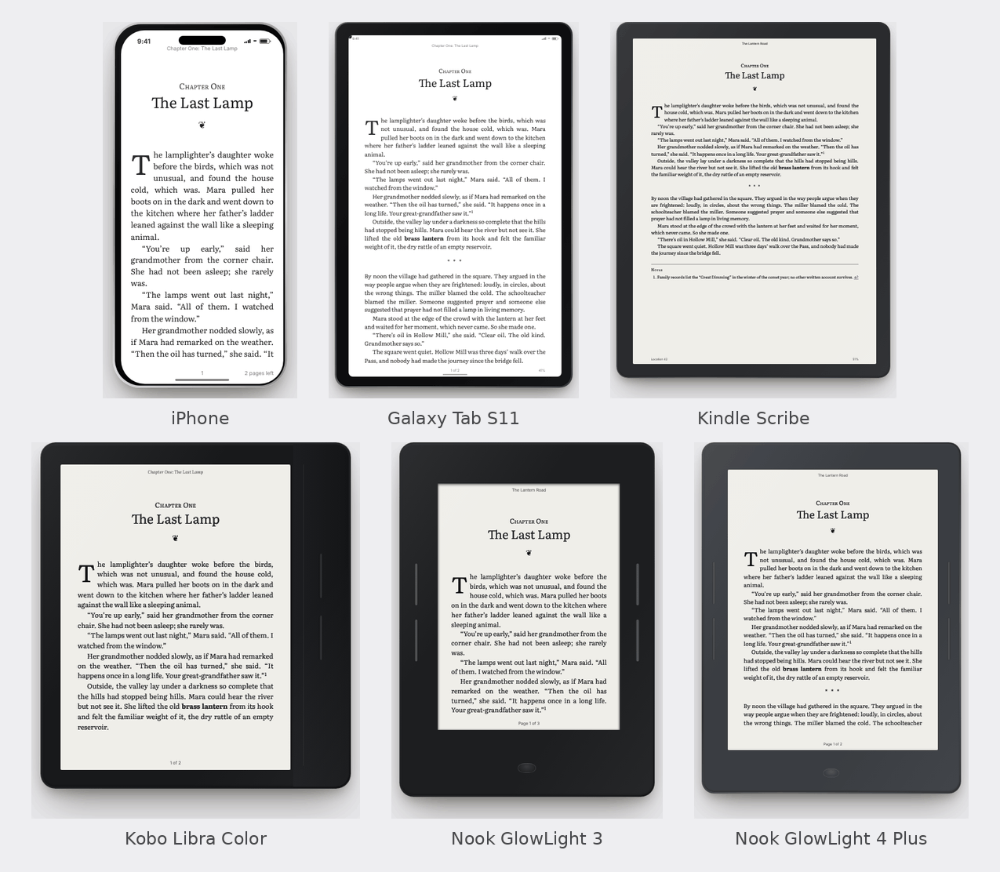

## Print, as an open book

Switch to **Print** to see facing pages exactly as the PDF will print them. The print view includes trim sizes, running heads, page numbers, footnotes, drop caps, chapters that start on a right-hand page and roman numerals for the front matter. Choose a **paper**, such as cream, bright white, ivory, natural, recycled, laid, linen, parchment, antique or newsprint, to see your pages on different stock. Paper changes only the preview, not the PDF. The open book always fits the view, whole and as large as possible. The **A–A** slider sets the body type size of the printed book, from 9 to 14 points in half-point steps, and shows the size as you hover over it or drag it.

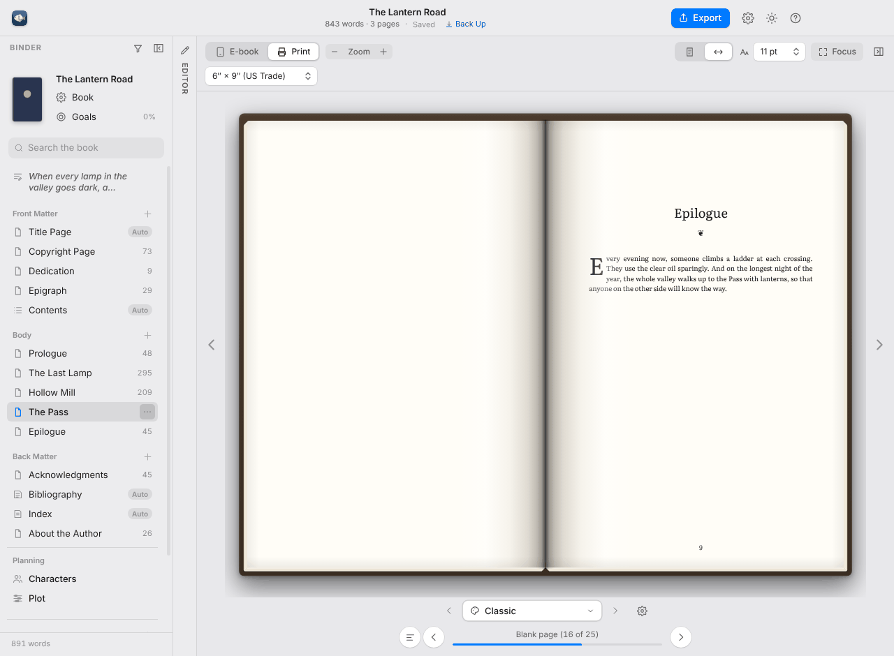

## Templates

A template sets the whole look of the book: fonts, chapter openings, drop caps, ornaments and scene breaks. Lutefisk includes 95 templates. Open the list under the device and press **↑** or **↓**. The device shows each design with example text, or with your own book when you turn on **Live**. Press **Enter** to keep a design, or **Esc** to go back. Click ⚙ to change a design. Your edited version is saved as *Modified*, and a design you build from scratch is saved as *Custom*.

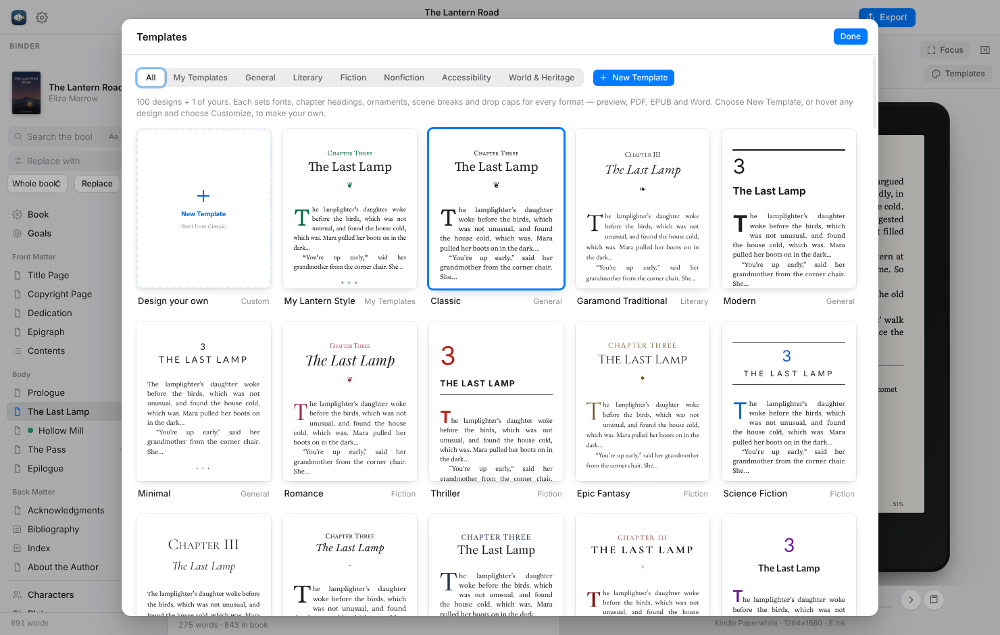

## Plan your story

### Characters

Give everyone in the story a card with a portrait, role, attributes and notes. Lutefisk finds each character in your manuscript and shows which chapters they appear in and how often.

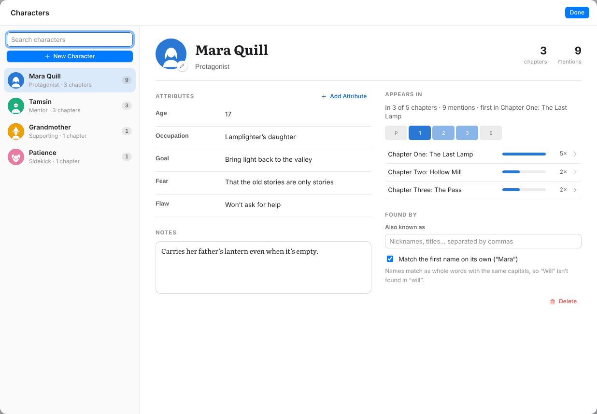

**Walkthrough**

1. Click **Characters** under Tools in the binder.
2. Click **New Character**. If your manuscript already has text, names that come up often are offered as chips. Click one to add that person.
3. Type the name, then a role such as Protagonist or Mentor. You can pick a role from the list or type your own.
4. Click the round portrait to choose a color and an icon, upload a picture (square, 256 × 256 px or larger), or use initials.
5. Fill in the attributes (age, goal, flaw, backstory and so on). **Add Attribute** adds your own. Use **Notes** for anything else.
6. Under **Found by**, list nicknames and titles in **Also known as**, separated by commas. Names match as whole words with the same capitals.
7. **Appears in** shows a strip with a square for each chapter (darker means more mentions) and a list of chapters and scenes. Click one to go there.

### Plot

Lay out the story on a board of cards, with a row for each plotline and a column for each chapter. Tag cards with characters, filter the board by character, and drag cards to re-plan.

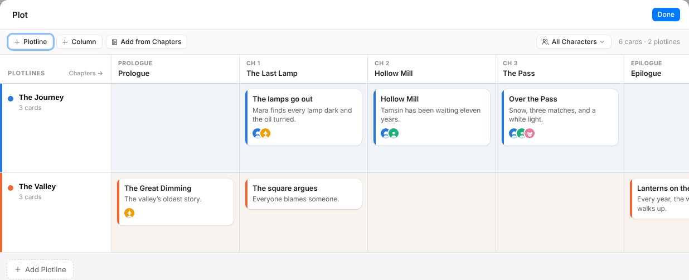

**Walkthrough**

1. Click **Plot** under Tools in the binder (⌥⌘L) and make sure **Board** is selected.
2. Rename the starting plotlines (Main Plot and Subplot) by clicking their names. **+ Plotline** adds a row, and **⋯** recolors, moves or deletes one.
3. Your chapters are already the columns, in book order. Click a chapter's name to open it. **+ Column** adds a free column for acts or beats.
4. Hover over a cell and click **+** (or double-click the cell) to add a card. Write what happens and tag the characters involved.
5. **Add from Chapters** turns chapters and scenes you've already written into cards or columns.
6. Drag cards between cells to re-plan. To delete a card, select it and press Delete.
7. Pick a name from **All Characters** to light up that person's cards and see where they drop out of the story.

### Timeline

The **Timeline** shows the same cards in the order things *happen* in the story, not the order you tell them. Give a card a **When**, such as "Spring 1922", "Day 3, dawn" or "Year 300", then drag it into place or press **Sort by When**. Add **events** for backstory and history that aren't scenes. A scene that's told after something that happens later is marked as a **Flashback**, so you can check that the order of the telling works. Open it from **Timeline** in the binder, or with the Board/Timeline switch on the Plot sheet.

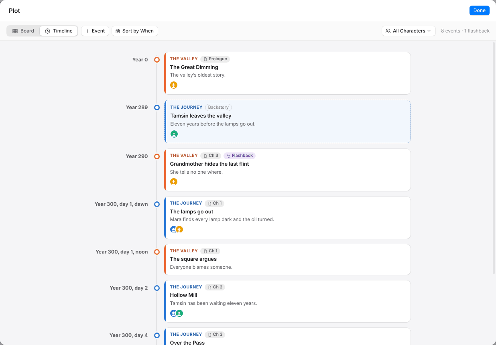

**Walkthrough**

1. Click **Timeline** under Tools in the binder, or switch the Plot sheet to **Timeline**. Every card from the board is already there.
2. Click **When?** beside a card and type a time in any form, such as "March 3, 1922", "Day 3, dawn", "Year 300" or "12 BC".
3. Press **Sort by When** to order everything by those dates and numbers, or drag cards into place yourself (⌥↑ and ⌥↓ also move the selected card).
4. Use **+ Event**, or the small **+** between two cards, to add backstory that happens off the page. Events have a dashed outline.
5. Each card shows its plotline and where it's told, such as **Ch 3**. Click that tag to open the chapter. A **Flashback** tag means the scene is told after something that happens later.
6. Click a card to edit its title, details, When, plotline, characters or chapter. Choosing a chapter puts an event on the board, and choosing "Timeline only" takes a card off it.

Each of these windows has a **How It Works** button that opens the same walkthrough in Help.

### Logline, Snippets and To-Do

- The **Logline** is your story in one or two sentences, aiming for 25 to 50 words.
- **Snippets** are passages saved for later, with full formatting. Drag one from the Snippets panel to the exact spot in a chapter. Once it's dropped, it leaves the list.
- The **To-Do** list tracks what's left for the book, with optional deadlines (tick **Today** to date new to-dos today), statistics, and a red badge in the binder for anything overdue.

<p>
  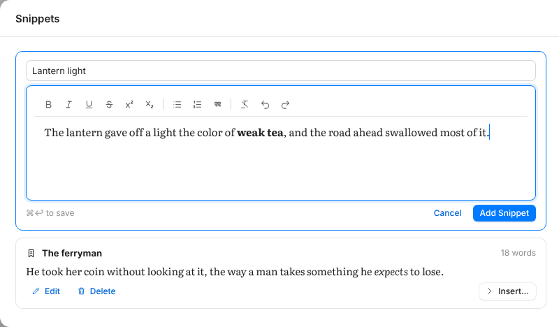
  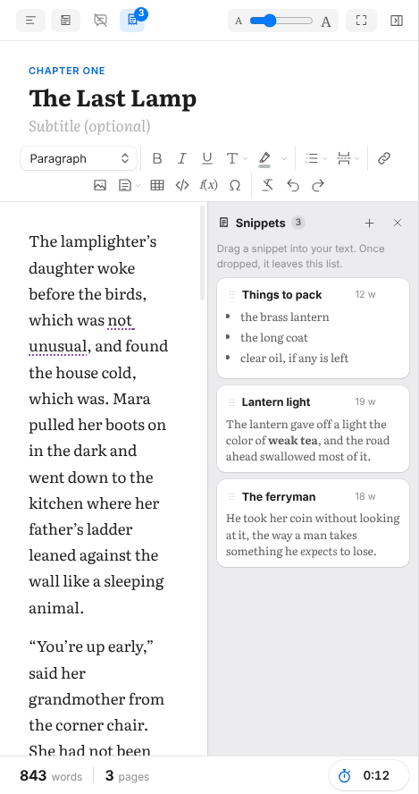
</p>

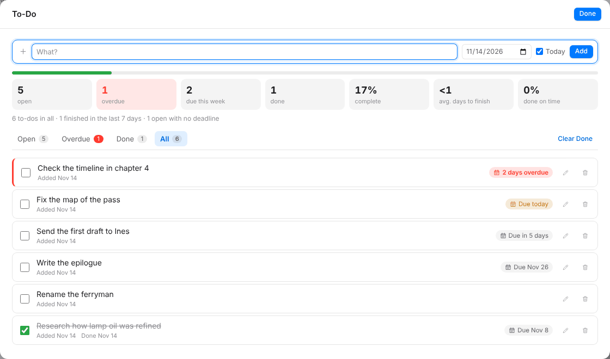

## Organize and recover

- **Labels** color-code chapters and scenes.
- **Statuses** can be combined: To Do, In Progress, First Draft, Needs Review, Reviewed, Revised, Finished, or your own.
- The **filter** in the binder shows only chapters and scenes with chosen labels or statuses, or only those excluded from export and print.
- The **Recycle Bin** at the bottom of the binder keeps everything you delete, including chapters, scenes, notes, snippets, to-dos, characters and plot cards. Restore puts an item back where it was.

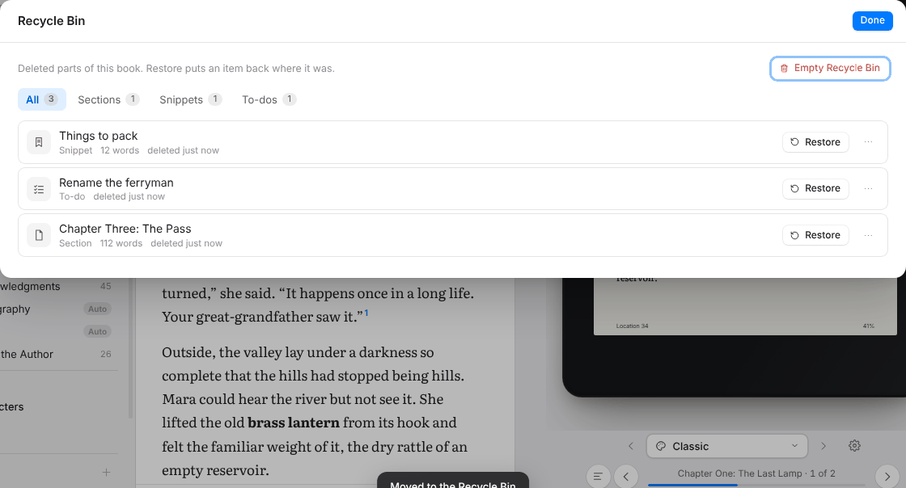

## Know your text

**Goals** turn a word target and a deadline into a daily goal. A daily goal can be in words, hours of writing, pages, or any mix of them, and a day counts as met when every part you set is met. To borrow a famous writer's habit, choose one from **Write like…**:

| Preset | Daily goal | Where it comes from |
|---|---|---|
| Stephen King | 2,000 words | His book *On Writing*: 2,000 words a day, a first draft in about three months |
| Maya Angelou | 5 hours | Wrote mornings in a rented hotel room from about 6:30 a.m. |
| Ernest Hemingway | 500 words | Wrote from first light and counted his words |
| Virginia Woolf | 3 hours | Wrote fiction from about 10 a.m. to 1 p.m. |
| Haruki Murakami | 1,600 words + 5 hours | Ten Japanese manuscript pages a day, starting at 4 a.m. |
| Margaret Atwood | 1,000 words | Aims for 1,000 to 2,000 words a day (the lower figure) |
| Anthony Trollope | 10 pages + 3 hours | 250 words every quarter hour, 5:30 to 8:30 a.m. |
| Joyce Carol Oates | 4½ hours | Writes from about 8:30 a.m. to 1 p.m. |
| Nicholas Sparks | 2,000 words + 5 hours | About 2,000 words, which takes him five to six hours |
| Nora Roberts | 6 hours | Works six to eight hours a day |

The figures come from the authors' own memoirs and interviews as commonly reported. Hours count your writing time (typing time, or the stopwatch if that's more), and a page is about 275 words.
 **Insights** charts your writing history and analyzes the text itself. It reports readability scores, sentence lengths, dialogue, adverbs, passive voice and a breakdown by chapter. **Reset…** clears the writing history for one book or for all of them.

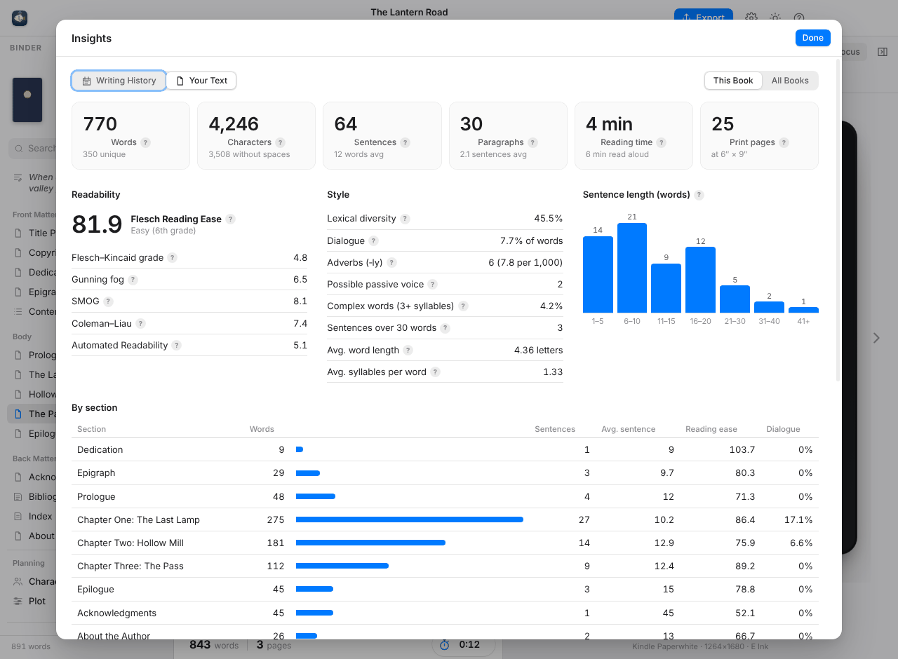

## Vision and comfort

**Settings › Vision & Comfort** makes Lutefisk easier to see and use:

- **Interface size** from 90% to 200%, and editor text from 25% to 300%.
- **An easier-to-read font,** Atkinson Hyperlegible, which is designed for low vision. It's used for the interface and the editor, while your book keeps its own fonts.
- **Stronger contrast,** which darkens secondary text and borders and underlines links. The **High Contrast** skin goes further, day or night.
- **Relaxed or loose line spacing** in the editor.
- **A bold focus ring** that always shows where keyboard focus is.
- **Reduce motion,** which turns off animations. Lutefisk also follows your computer's reduce-motion setting.

In exported books, equations keep their LaTeX as alt text and images keep their descriptions, so screen readers can read them.

<p>
  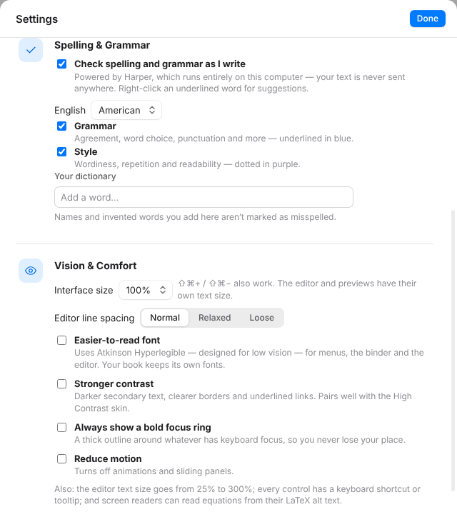
</p>

## Your language

**Settings › Language** shows Lutefisk's menus, buttons and labels in English (US or UK), German, French, Italian, Spanish, Polish, Russian, Ukrainian, Indonesian, Malay, Vietnamese, Japanese, Chinese (Simplified) or Korean. This changes only the app, never your book; your book's language is set in **Book › General**. The most-used menus, buttons and labels are translated, and anything not yet translated appears in English.

Lakota (Lakȟótiyapi) is listed but has only a few words so far. Software terms in Lakota should come from fluent speakers and language programs, so the rest stays in English until reviewed translations are contributed. The strings live in `scripts/locales.tsv`, one row per English phrase and one column per language; run `npm run locales` after editing it.

## Make it yours

Lutefisk has day and night modes and 14 skins. Some skins are plain colors, and others add a texture, such as stitched Leather, a walnut Study, woven Linen, a Blueprint grid or Midnight's field of stars.

<p>
  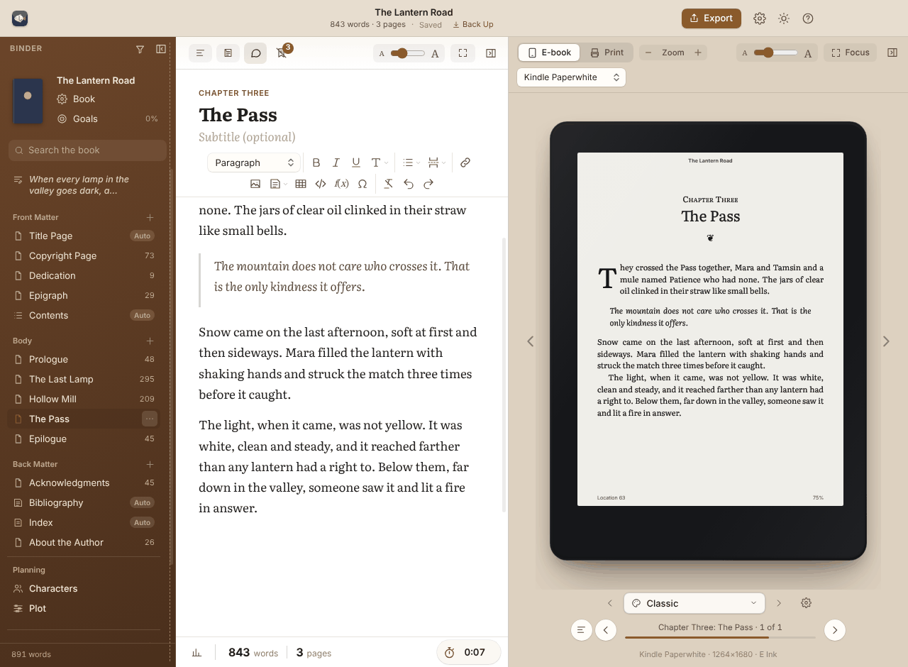
  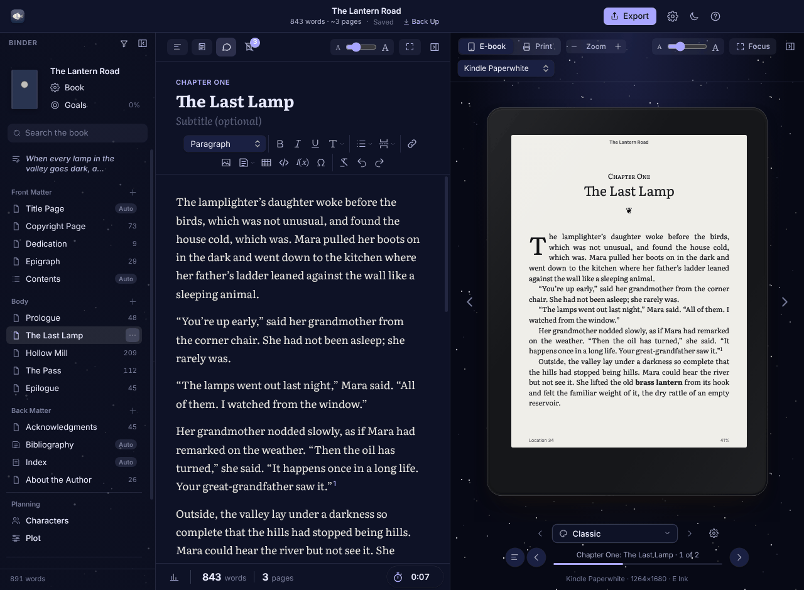
</p>

## Features at a glance

| | |
|---|---|
| **Write** | Paragraph styles (including Attribution), lists with custom bullets, a highlighter, footnotes, citations, equations, tables, images, inline code and code blocks with optional colors and line numbers, comments, find and replace, Focus mode, and a title capitalization check that follows your citation style |
| **Check** | Spelling, grammar and style checking by Harper, run locally, automatically or on demand (F7), with a personal dictionary and five English dialects |
| **Structure** | Front matter, chapters and scenes, and back matter, with a generated title page, contents, bibliography and index |
| **Plan** | A logline, characters with portraits, a plot board, a story timeline that marks flashbacks, formatted snippets you drag into place, and a to-do list with deadlines and statistics |
| **Organize** | Labels, multiple statuses and Exclude from Export, with a binder filter and a Recycle Bin |
| **Track** | A live word and page count as you type, daily goals, a stopwatch, writing history (which you can reset) and text insights |
| **Preview** | Eleven phones, tablets and e-readers (Apple, Android, Kindle, Kobo and Nook) drawn to scale, plus a print view with facing pages and ten paper stocks |
| **Language** | Menus and buttons in 15 languages, with Lakota in progress |
| **Export** | EPUB, PDF, Word, RTF, MOBI, Markdown and plain text |
| **Back up** | Save a .zip or a folder copy of any book, beside the book or anywhere you choose (⇧⌘S) |
| **Access** | Interface size, an easier-to-read font, stronger contrast, line spacing, focus rings and reduced motion |
| **Learn** | Built-in help with search, and a guided tour that walks you through your first book (F1) |

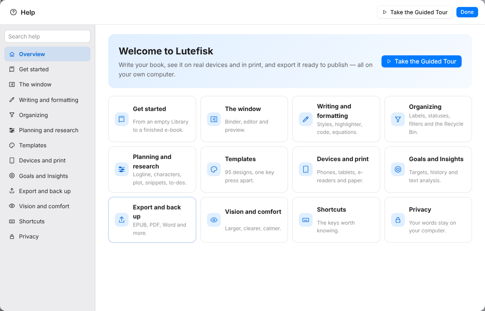

## Getting started

You need [Node.js](https://nodejs.org) 22 or later.

```bash
npm ci        # install dependencies
npm start     # build and launch Lutefisk
npm test      # run the unit tests
```

To build an installable app, run `npm run package:mac`, `npm run package:win` or `npm run package:linux` on that system.

New to Lutefisk? Click **?** in the title bar or press **F1**. The guided tour walks you through making your first book.

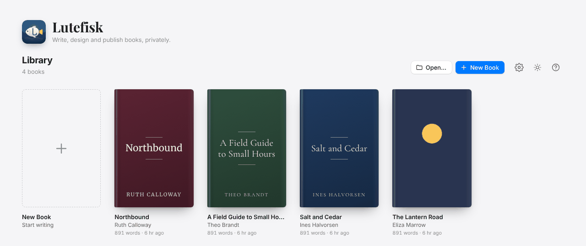

## Your books

Each book is an ordinary folder, so you can copy it, sync it yourself or put it under version control. A **`lutefisk.yaml`** file inside marks the folder as a Lutefisk book:

```
My Book/
├── lutefisk.yaml   title, authors, template, settings, snippets and to-dos
├── chapters/       one Markdown file per chapter
├── research/       notes and files that belong to the book but never print
└── assets/         cover, pictures and character portraits
```

Books made with earlier versions of Lutefisk kept this file as `book.yaml`. They still open, and the file is renamed the next time the book is saved.

When you run Lutefisk from its source folder, new books go in `local/books`. Git ignores that folder, so your writing is never committed. A packaged copy of the app keeps books in `Documents/Lutefisk` instead. You can change the folder in Settings.

## Privacy and security

- **Nothing leaves your computer.** The app window is blocked from making network requests and can load only Lutefisk's own files. There is one exception: the Bibliography tool fetches a link that you paste. It sends no cookies and none of your book, and it refuses addresses on your local network.
- **Local spelling and grammar.** Harper runs inside the app as WebAssembly, using a dictionary that ships with Lutefisk.
- **Locked-down interface.** The interface is sandboxed and context-isolated, runs under a strict Content-Security-Policy and talks to the rest of the app only through a narrow bridge. The app checks every file path before it touches a file.
- **Safe Markdown.** Raw HTML is disabled. Links must use http, https or mailto, and pictures must come from the book's own `assets` folder.
- **Hardened builds.** Packaged builds turn on Electron's security fuses and refuse debugging switches.
- **Clean dependencies.** `npm audit` reports no vulnerabilities, and `npm run check:deprecated` finds no deprecated packages.
- **Software bill of materials.** `npm run sbom` writes CycloneDX 1.5 and SPDX 2.3 files and a readable summary to `sbom/`.

## Project layout

```
src/main/          main process: windows, files, exports, PDF printing
src/preload/       the narrow bridge to the interface
src/renderer/      the interface: editor, previews, panels, help, spell checking
src/shared/        Markdown, templates, fonts, citations, book → HTML
scripts/           build, package, SBOM, sample book
test/              unit and end-to-end tests
docs/screenshots/  the images in this README, made from a sample book
CLAUDE.md          the full specification
```

## Disclaimer

Lutefisk is an **experimental, unsupported** personal project.

- **No support.** Questions, bug reports and feature requests may go unanswered.
- **No warranty.** The software is provided "as is", without warranty of any kind. You use it at your own risk.
- **Things may change.** Features can change or disappear between versions, and the book format may change without a migration path.
- **Back up your work.** Lutefisk saves your books as ordinary files on your computer and includes a Back Up command, but it is not a substitute for your own backups.
- **Not for publishing decisions.** Previews and exports aim to be accurate, but always check your files in the store's or printer's own tools before you publish.
- **AI.** The app uses no AI, but it was built with the help of AI coding tools. Review the code yourself before relying on it.
